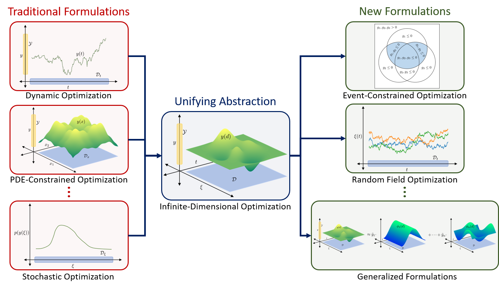

# Infinite-Dimensional Optimization Case Studies
This repository contains the source-code Julia scripts used in the case studies 
featured in the manuscript "A Unifying Modeling Abstraction for 
Infinite-Dimensional Optimization" by Joshua L. Pulsipher, Weiqi Zhang, 
Tyler J. Hongisto, and Victor M. Zavala.



## Implementation
First, you'll need to install Julia (available at https://julialang.org/downloads/).
Then you'll find instructions about running each case study on the `README.md` 
file within each case study folder.

## Reference
This code accompanies the paper:

Joshua L. Pulsipher, Weiqi Zhang, Tyler J. Hongisto, and Victor M. Zavala. "A unifying modeling abstraction for infinite-dimensional optimization." *Computers & Chemical Engineering* 156 (2022): 107567. https://doi.org/10.1016/j.compchemeng.2021.107567

Preprint: https://arxiv.org/abs/2106.12689

## BibTeX
```bibtex
@article{pulsipher2022unifying,
  title   = {{A unifying modeling abstraction for infinite-dimensional optimization}},
  author  = {Pulsipher, Joshua L. and Zhang, Weiqi and Hongisto, Tyler J. and Zavala, Victor M.},
  journal = {Computers \& Chemical Engineering},
  volume  = {156},
  pages   = {107567},
  year    = {2022},
  doi     = {10.1016/j.compchemeng.2021.107567}
}
```

## Authors
Joshua L. Pulsipher, Weiqi Zhang, Tyler J. Hongisto, and Victor M. Zavala
