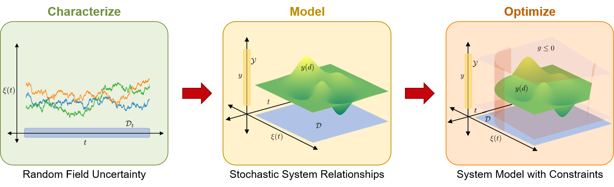

# Random Field Optimization Case Studies
This repository contains the source-code Julia scripts used in the case studies 
featured in the manuscript "Random Field Optimization" by Joshua L. Pulsipher, 
Benjamin R. Davidson, and Victor M. Zavala.



## Implementation
First, you'll need to install Julia (available at https://julialang.org/downloads/).
Then you'll find instructions about running each case study on the `README.md` 
file within each case study folder.

## Reference
This code accompanies the paper:

Joshua L. Pulsipher, Benjamin R. Davidson, and Victor M. Zavala. "Random field optimization." *Computers & Chemical Engineering* 165 (2022): 107854. https://doi.org/10.1016/j.compchemeng.2022.107854

Preprint: https://arxiv.org/abs/2201.09951

## BibTeX
```bibtex
@article{pulsipher2022random,
  title   = {{Random field optimization}},
  author  = {Pulsipher, Joshua L. and Davidson, Benjamin R. and Zavala, Victor M.},
  journal = {Computers \& Chemical Engineering},
  volume  = {165},
  pages   = {107854},
  year    = {2022},
  doi     = {10.1016/j.compchemeng.2022.107854}
}
```

## Authors
Joshua L. Pulsipher, Benjamin R. Davidson, and Victor M. Zavala
